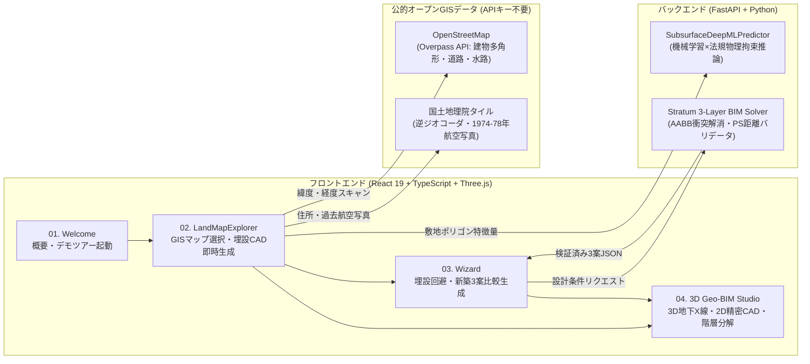

# STRATUM GEO-BIM（ストラタム・ジオ・ビム）

> **「目に見えない『土地の記憶』を透視し、地下から建築を定義する。」**  
> 地図上で土地をタップするだけで、周囲の建物・前面道路・過去の建物履歴（GIS・1970年代航空写真）から **地下のガス管・上下水管・隣地越境管・残置コンクリート杭** を機械学習＆法規物理拘束モデルで推論し、**実測CAD埋設伏図・GL深度断面図・埋設干渉ゼロの新築3層BIMモデル** を同時生成するプラットフォーム。


---

<<<<<<< HEAD
## 📌 1. 背景と解決する社会課題（Why STRATUM GEO-BIM?）
=======
##  1. 背景と解決する社会課題（Why STRATUM GEO-BIM?）
>>>>>>> 3af0a65ba76d488b6cb8fbe0723cac1a58acb38f

建設・不動産・解体工事の現場には、**「地面の下（地下）に何が埋まっているか、重機で掘ってみるまで分からない」** という深刻なブラックボックス問題が存在します。

1. **重機掘削時のインフラ破断・ガス漏洩事故**
   - 解体更地や古い住宅密集地では、図面に残っていない古い白ガス管（GL-0.6m）や鉛給水管、さらに **「隣家の配管が敷地境界を越えて地下を横切っている（隣地越境管）」** ケースが多発しており、掘削時の破損事故リスクが絶えません。
2. **地中障害物（残置杭・旧浄化槽）による数百万〜数千万円の突発損失**
   - 現況が「コインパーキング」や「更地」に見えても、過去にRC造ビルや工場、古い木造住宅が建っていた土地では、地下深く（GL-1.8m〜-8.5m）に **残置PHC杭・旧浄化槽・地下タンク** が放置されていることがあります。着工後に発覚すると、基礎工事がストップし **50万〜500万円以上の撤去費用** と大幅な工期遅延が発生します。
3. **初期検討段階における調査手段の欠如**
   - 役所の台帳は「道路の本管」しか記載されておらず、敷地内の引込管や残置物は不明です。一方、物理的な地中レーダー探査（GPR）や試掘は数十万円の費用と数週間の期間を要するため、土地の買付判断や初期設計段階では実施できません。

**STRATUM GEO-BIM** は、オープンGISデータ・過去の航空写真・日本のインフラ法規（ガス事業法・水道法・下水道法）と機械学習を組み合わせることで、**「掘る前・買う前に、0円・数秒で地下リスクを透視し、埋設物と干渉しない建築基本設計までを一気通貫で完了させる」** ために開発されました。

---

<<<<<<< HEAD
## 🚀 2. 既存ソリューションとの決定的な差別化
=======
##  2. 既存ソリューションとの決定的な差別化
>>>>>>> 3af0a65ba76d488b6cb8fbe0723cac1a58acb38f

| 比較軸 | 従来の「間取り生成AI」 | 物理探査（地中レーダー・試掘） | **STRATUM GEO-BIM（本プロダクト）** |
| :--- | :--- | :--- | :--- |
| **敷地の扱い** | 土地を「ただの白い四角形」として扱う | 実測するが設計機能はない | **OpenStreetMapから実測多角形（台形・隅切り）と各辺寸法を自動抽出** |
| **更地・駐車場の識別** | 建物がない更地でも毎回同じ「架空の4LDKの部屋」を出力してしまう（ハルシネーション） | ― | **現況（更地・駐車場・既存建物）を厳密判定。更地では嘘の部屋を描かず実測境界と地下引込管・メーターのみを作図** |
| **地下インフラとの整合** | 地面の下を無視するため、**AIが描いた柱の真下にガス管や残置杭があり実際には建たない** | 埋設物の有無のみを調査 | **地下の埋設管・残置杭を先に推論し、それらを回避する位置に新築の柱・基礎・給排水縦管（PS）を自動配置** |
| **コスト・スピード** | 数秒（ただし現場利用不可な簡易図） | 数十万円 ／ 数週間 | **0円（APIキー不要の公的GIS活用） ／ 数秒で2D CAD＆3D地下X線図を出力** |

---

<<<<<<< HEAD
## ✨ 3. 主要機能（Key Features）

### ① 現場タブレット対応・GISランドスキャナー（`LandMapExplorer`）
=======
##  3. 主要機能（Key Features）

### ① 現場タブレット対応・GISランドスキャナー（`LandMapExplorer.tsx`）
>>>>>>> 3af0a65ba76d488b6cb8fbe0723cac1a58acb38f
- **リアルタイム空間データ収集**: マップ上の任意の土地をタップするだけで、OpenStreetMap（Overpass API）から対象敷地の多角形ポリゴン、周囲45m圏内の建物密度・階数、前面道路の方位・幅員、最寄り水路距離を自動計測。
- **1974〜78年（昭和期）航空写真タイムマシン**: 国土地理院のシームレス航空写真と1970年代の過去航空写真をワンタップで切り替え、現在更地や駐車場になっている土地に「かつて何が建っていたか」を視覚的に照合。
- **ハルシネーション排除の安全設計**: 更地（`vacant_lot`）やコインパーキング（`parking_lot`）をスキャンした際は、存在しない部屋の描画を抑制し、実測区画形状と地下残置インフラのみを正確に表示。

### ② 機械学習×法規物理拘束による地下埋設推論エンジン（`Stratum-SubsurfaceNet`）
- 敷地ポリゴンの幾何学的特徴量（面積・周囲長・有効接道長・アスペクト比）と周辺・履歴コンテキストから以下を推論：
  - **都市ガス管（低圧白ガス管・PE管 GL-0.6m ／ 中圧本管 GL-1.2m）** の口径（20A〜50A）と引込経路
  - **上水道引込管（GL-0.45m〜-0.9m）・汚水排水管（自然流下勾配 1/100）**
  - **隣地越境配管リスク確率（`crossBorderRiskProb`）**
  - **地中残置障害物（旧単独浄化槽・残置PHC杭群 GL-8.5m・旧地下タンク）** の存在確率と **概算撤去費用（万円）**

<<<<<<< HEAD
### ③ プロ実務仕様の2D CAD自動作図（`SubsurfaceInferenceEngine` / `ArchitecturalDrawings`）
- **地下埋設調査CAD図（平面伏図＋GL深度垂直断面図）**: 多角形敷地境界線、各辺の実測寸法、道路本管、引込管、ガスメーター（GM）・水道メーター（WM）・最終ます、試掘推奨ポイントをJIS規格の線種・ハッチングで出力。
- **建築1F/2F平面詳細図（間取り図）**: 柱グリッド、耐力壁、建具（ドア開閉アーク・窓サッシ）、住宅設備シンボル（システムキッチン・ユニットバス1616・トイレ・洗面）、畳数表記を含む業務レベルのSVG図面を生成・エクスポート。

### ④ 3D地下X線透視＆3レイヤー建築BIMスタジオ（`ai_bim_3d`）
=======
### ③ プロ実務仕様の2D CAD自動作図（`SubsurfaceInferenceEngine.tsx` / `ArchitecturalDrawings.tsx`）
- **地下埋設調査CAD図（平面伏図＋GL深度垂直断面図）**: 多角形敷地境界線、各辺の実測寸法、道路本管、引込管、ガスメーター（GM）・水道メーター（WM）・最終ます、試掘推奨ポイントをJIS規格の線種・ハッチングで出力。
- **建築1F/2F平面詳細図（間取り図）**: 柱グリッド、耐力壁、建具（ドア開閉アーク・窓サッシ）、住宅設備シンボル（システムキッチン・ユニットバス1616・トイレ・洗面）、畳数表記を含む業務レベルのSVG図面を生成・エクスポート。

### ④ 3D地下X線透視＆3レイヤー建築BIMスタジオ（`ai_bim_3d.tsx`）
>>>>>>> 3af0a65ba76d488b6cb8fbe0723cac1a58acb38f
- **3D地下X線モード**: 地上建物を半透明化し、地下の地層（表土・ローム層・支持層）に埋まるガス管・水道管・残置杭と新築基礎のクリアランスをWebGL（Three.js）で立体透視。
- **建築3レイヤー（Stratum）分解**:
  - **Layer 1: Skeleton（構造層）** — 通し柱・大梁・小梁・耐力壁・基礎スラブ
  - **Layer 2: MEP（設備層）** — 給排水縦シャフト（PS）・空調換気ダクト（DS）
  - **Layer 3: Infill（意匠・空間層）** — 居室ゾーニング・天井高・床仕上げ・開口部
- **物理整合性バリデータ＆自動修復（`validate_and_repair_blueprint`）**: 敷地境界はみ出し、同一階の部屋同士のAABB衝突、水回り部屋と給排水シャフト（PS）の距離違反（3.5m以内制約）をミリ秒単位で検知・自動補正。
- **3Dシネマツアー＆動画書き出し**: プレゼン用の自動カメラワーク再生および `.webm` 動画ファイルのワンクリック録画機能を搭載。

---

<<<<<<< HEAD
## 🏗️ 4. システムアーキテクチャ



---

## 📦 5. 必要なライブラリ・動作環境（Dependencies & Requirements）

### 前提ランタイム環境
- **Node.js**: `v18.0` 以上（推奨 `v20`〜`v24`） / `npm`
- **Python**: `3.10` 以上

### フロントエンド使用ライブラリ（`project/package.json`）
`cd project && npm install` で以下が自動インストールされます。

| パッケージ名 | バージョン | 用途・役割 |
| :--- | :--- | :--- |
| `react` / `react-dom` | `^19.0.0` | UIコンポーネント・状態管理（GISマップ・CAD・3Dビューの同期） |
| `three` / `@types/three` | `^0.174.0` | WebGL 3Dエンジン（3D地下X線透視・地層・埋設管・3層BIM描画） |
| `tailwindcss` / `@tailwindcss/vite` | `^4.1.0` | スタイリング（ダークGISテーマ・タブレット対応レスポンシブUI） |
| `lucide-react` | `^0.487.0` | 建築・測量・CAD操作用ベクターアイコン |
| `vite` / `@vitejs/plugin-react` | `^6.2.0` | 高速フロントエンドビルド・開発サーバー |
| `typescript` | `~5.7.2` | 3層BIMスキーマ・地理空間座標の厳密な型安全性保証 |

### バックエンド使用ライブラリ（`requirements.txt`）
`pip install -r requirements.txt` で以下がインストールされます（※機械学習推論エンジン `subsurface_ml_engine.py` およびデータ生成器はPython標準ライブラリの `math`, `dataclasses`, `json` 等のみで高速動作するようゼロ依存設計されています）。

| パッケージ名 | バージョン | 用途・役割 |
| :--- | :--- | :--- |
| `fastapi` | `>=0.110.0` | 地下埋設ML推論・3層BIM生成・物理バリデーション用REST APIサーバー |
| `uvicorn[standard]` | `>=0.27.0` | FastAPI起動用ASGIサーバー |
| `pydantic` | `>=2.6.0` | リクエスト/レスポンスのJSONスキーマ検証・型バリデーション |
| `torch` *(任意)* | `>=2.1.0` | `backend/train_qlora.py` によるSLM学習スクリプト実行時のみ使用 |

### 外部API・データソース（すべてAPIキー不要・無料）
- **OpenStreetMap Overpass API**: 建物ポリゴン頂点・階数・道路幅員・水路データのリアルタイム取得
- **国土地理院 タイル＆逆ジオコーダAPI**: 標準地図・最新航空写真・1974〜78年過去航空写真・住所逆引き

---

## ⚡ 6. クイックスタート（インストール＆起動方法）

### 初回セットアップ（ライブラリのインストール）
```powershell
# 1. Pythonバックエンド用ライブラリのインストール
pip install -r requirements.txt

# 2. フロントエンド用パッケージのインストール
cd project
npm install
cd ..
```

### 方法A：ワンコマンド自動起動（推奨）
バックエンド（FastAPI: Port `8000`）とフロントエンド（Vite: Port `5173`）をバックグラウンドで同時起動し、ヘルスチェック完了後に自動でブラウザを開きます。

```powershell
# 起動（バックグラウンド起動＋ヘルスチェック＋ブラウザ自動オープン）
python start_studio.py
# または Windows バッチファイルから起動
.\start_studio.bat

# 停止したいとき
python start_studio.py --stop
```

### 方法B：フロントエンド・バックエンドを個別に起動する場合

#### 1. フロントエンド（Vite + React）の起動
※ フロントエンド単体でもクライアント側ML推論フォールバックにより、地図スキャン・地下埋設CAD・3Dスタジオのすべての機能が動作します。

```powershell
cd project
=======
##  4. クイックスタート（起動方法）

```powershell
# ルートディレクトリから一括起動する場合
python ../start_studio.py

# フロントエンド単体で起動する場合
>>>>>>> 3af0a65ba76d488b6cb8fbe0723cac1a58acb38f
npm install
npm run dev
```
ブラウザで `http://localhost:5173` を開きます。

<<<<<<< HEAD
#### 2. バックエンド（FastAPI 推論・物理バリデータサーバー）の起動
```powershell
pip install -r requirements.txt
python backend/server.py
```
APIドキュメント（Swagger UI）は `http://127.0.0.1:8000/docs` で確認できます。

---

## 🔌 7. 主要APIエンドポイント一覧

| メソッド | エンドポイント | 説明 |
| :--- | :--- | :--- |
| `GET` | `/api/health` | サーバー稼働状態およびスキーマ整合性のヘルスチェック |
| `POST` | `/api/predict-subsurface-ml` | 敷地ポリゴン頂点・道路幅員・周辺建物密度・旧建物履歴から地下配管深度・口径・障害物確率をML推論 |
| `POST` | `/api/generate-from-spec` | 敷地面積・階数・用途・方位から物理制約を満たす新築3層BIMプラン（A/B/Cの3案）を生成 |
| `POST` | `/api/generate-blueprint` | 自然言語要件から3層BIM JSONを生成し、AABB干渉・給排水シャフト距離違反を自動補正 |
| `POST` | `/api/validate-blueprint` | 既存のBIM JSONデータの物理・法規整合性を検証し自動修復レポートを返却 |
| `POST` | `/api/export-svg` | 構造化BIM JSONから2D建築CAD図面（SVG）をサーバーサイドレンダリング |

---

## 📂 8. ディレクトリ構成

```text
ハッカソンProject/
├── README.md                          # 本ドキュメント
├── PRESENTER_MANUAL.md                # 発表者用・プロジェクト完全理解＆ピッチ攻略マニュアル
├── requirements.txt                   # Pythonバックエンド依存パッケージ一覧
├── .gitignore                         # Git除外設定 (node_modules, __pycache__, logs等)
├── start_studio.py                    # バックエンド＆フロントエンド一括起動・ヘルスチェックスクリプト
├── start_studio.bat                   # Windows用ワンクリック起動バッチ
├── schema/
│   └── stratum_bim_schema.json        # 建築3層（Structure / MEP / Infill）厳密JSONスキーマ定義
├── backend/
│   ├── server.py                      # FastAPI 推論サーバー＆物理整合性バリデータ
│   ├── subsurface_ml_engine.py        # 地下埋設インフラ・地中障害物 機械学習/物理拘束推論エンジン
│   ├── dataset_generator.py           # 3層BIM学習データ生成器（住宅・商業・クリニック・ラボ対応）
│   ├── verify_pipeline.py             # E2Eパイプライン検証＆SVG図面エクスポーター
│   └── train_qlora.py                 # SLM用 QLoRA ファインチューニングスクリプト
└── project/                           # フロントエンドアプリケーション (Vite + React + Three.js)
    ├── index.html
    ├── package.json
    ├── main.tsx                       # エントリーポイント
    ├── Root.tsx                       # 画面遷移ルーター (Welcome -> Map -> Wizard -> Studio)
    ├── Welcome.tsx                    # ランディング画面・4フェーズ解説＆デモツアー起動
    ├── LandMapExplorer.tsx            # フィールドGISマップ探索・土地スキャン・即時CADドロワー
    ├── realSiteData.ts                # OpenStreetMap / 国土地理院 リアルタイム空間データ解析＆ML連携
    ├── SubsurfaceInferenceEngine.tsx  # 地下埋設推論ロジック＆多角形測量CAD（平面伏図＋GL断面図）描画
    ├── ArchitecturalDrawings.tsx      # JIS建築CAD平面詳細図・建具シンボル・階層アクソメ図レンダラー
    ├── Wizard.tsx                     # 地下埋設整合・新築プラン3案比較ウィザード
    └── ai_bim_3d.tsx                  # Three.js 3D地下X線透視＆3層BIMインタラクティブスタジオ
```

---

## 📖 9. プレゼン・発表者向け資料

ハッカソンでのデモンストレーション手順、審査員からの想定質問（Q&A対策）、および専門用語（GL、伏図、越境管、PHC残置杭など）の解説については、リポジトリ内の **[PRESENTER_MANUAL.md](./PRESENTER_MANUAL.md)** をご参照ください。

=======
>>>>>>> 3af0a65ba76d488b6cb8fbe0723cac1a58acb38f
